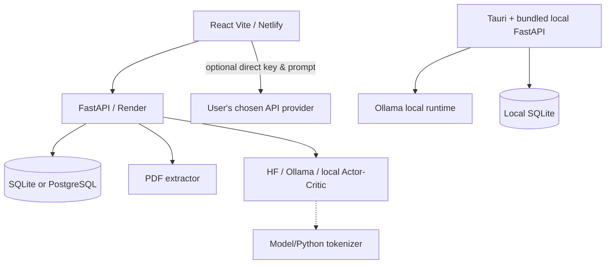

# PACE — Pipelined Actor-Critic Ensemble


[](https://github.com/KiritoTempest175/PACE/actions/workflows/ci.yml)
[](LICENSE)

**Desktop branch: Tauri 2 with a bundled loopback FastAPI service and native OS credential handling.**

**PACE is an open-source coding and PDF-literacy AI workspace with transparent Fast and Pro inference, a React dashboard, and optional local desktop models.**

[Web app](https://pace.huzaifazaman.com) · [Documentation](docs/RELEASE_GUIDE.md) · [Security](SECURITY.md) · [Privacy](docs/RELEASE_GUIDE.md#privacy-and-retention)

## Features and limitations

| Feature | Actual behavior |
| --- | --- |
| Coding | Configured model inference; code-fence copy, wrap and download; Pyodide worker runner |
| Literacy | Validated PDF upload and excerpt-based document questions |
| Fast | One generation pass; Ollama can auto-continue bounded length finishes |
| Pro | Draft and second review pass where implemented; hosted model can reuse the same weights |
| Custom providers | OpenAI-compatible, OpenRouter, Anthropic and Google direct browser connections; provider CORS restrictions apply |
| Credentials | Browser keys kept in memory, not transmitted to the PACE backend; desktop keyring implementation needs native verification |
| Models | Ollama is the supported local runner; discovered GGUF/safetensors files are not proof of runnable direct loading |
| History | Backend database stores session-scoped conversations, messages and extracted PDF text |
| Long outputs | Explicit context/output bounds and errors; no guarantee of infinite-length results or resumable SSE replay |

## Architecture



## Quick start: shared API and frontend

Requires Python 3.10+, Node.js 20+, and optionally Ollama for local generation.

```bash
cp .env.example .env
python -m venv .venv
pip install -r backend/requirements.txt
uvicorn backend.main:app --reload --port 8000
```

In another terminal:

```bash
cd frontend
npm ci
npm run dev
```

For actual inference configure `AI_PROVIDER=ollama` and an installed `OLLAMA_MODEL`, or `AI_PROVIDER=huggingface` with a verified `HF_SPACE_ID`. Disabled providers do not synthesize placeholder responses.

## Desktop build

Checkout `feature/tauri-desktop`. PACE Desktop packages a loopback FastAPI sidecar, SQLite and a Tauri UI. The `.github/workflows/desktop-native-ci.yml` workflow attempts **unsigned** native bundles for Windows, macOS and Linux and publishes build artifacts only, never a production release. Actual results and on-device checks must be verified before distributing installers.

## Configuration and testing

See [environment example](.env.example), [release architecture/FAQ](docs/RELEASE_GUIDE.md) and [deploy guide](docs/DEPLOYMENT.md). The default retention period is 30 days, pruned at API startup. `DELETE /my-data` erases the current session's database records, not backups or third-party copies.

```bash
pip install -r requirements-dev.txt
pytest -q tests
cd frontend
npm ci
npm run lint
npm test
npm run build
```

**Limits:** browser direct API calls may be blocked by CORS; long input beyond the explicit token estimate returns HTTP 413; some hosted model providers and free quotas may stop output despite keep-alives. Reconnect replay is not implemented. Avoid storing sensitive documents where third-party data retention is unacceptable.

## Project layout

- `frontend/`: dashboard, workspaces, model controls, docs/privacy pages, browser runner and tests
- `backend/`, `masteries/api/`: FastAPI, request validation, SSE and session ownership
- `masteries/services/`: inference providers, SQLite/PostgreSQL persistence, PDF processing and telemetry
- `ai-service/`: hosted Hugging Face inference adapter
- `desktop/`, `frontend/src-tauri/` (desktop branch): model discovery, Python sidecar and native OS keychain
- `core/`, `infra/`: configuration and opt-in local sandbox
- `docs/`: architecture, deployment, tests and troubleshooting

## Roadmap

- Provider-aware completion metadata and resumable streams
- True context-token counting and large document chunking
- Verified direct GGUF support if runtime testing establishes it
- OS-specific installation and accessibility audits

## License & contact

MIT — [LICENSE](LICENSE). Contributions: [CONTRIBUTING.md](CONTRIBUTING.md). Report security issues privately per [SECURITY.md](SECURITY.md).

**Maintainer:** [huzaifazaman38@gmail.com](mailto:huzaifazaman38@gmail.com) · [huzaifazaman.com](https://huzaifazaman.com) · [GitHub](https://github.com/KiritoTempest175)
