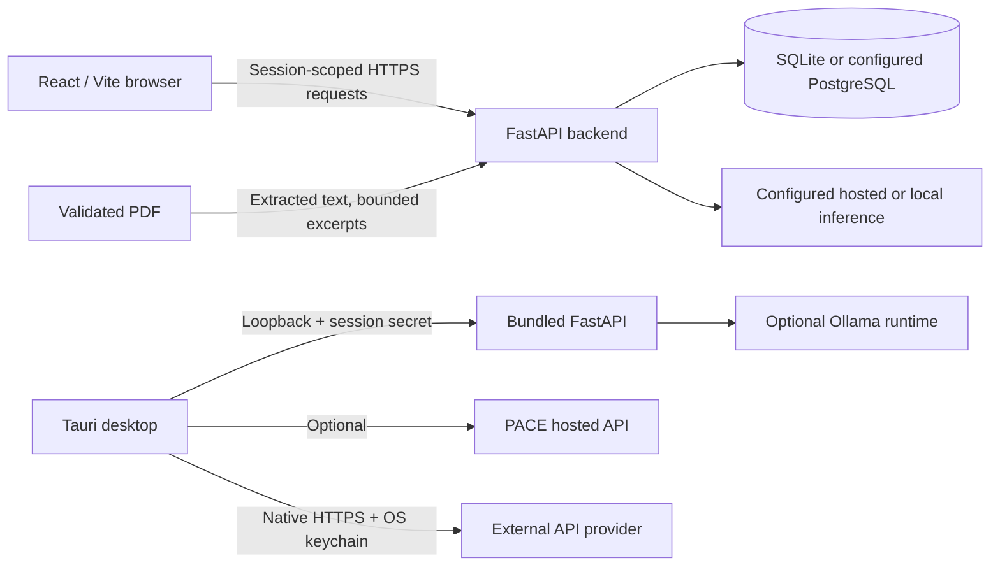

# PACE · Pipelined Actor-Critic Ensemble


[](https://github.com/KiritoTempest175/PACE/actions/workflows/ci.yml)

[](LICENSE)

**One workspace for programming, everyday conversation, and optional PDF questions.** PACE combines a React interface with a Python FastAPI backend and configurable model inference. A second model review can be requested in Pro mode; review is not a correctness guarantee.

[**Launch web app**](https://pace.huzaifazaman.com) · [**Desktop installers**](https://pace.huzaifazaman.com/) · [**Desktop code**](https://github.com/KiritoTempest175/PACE/tree/feature/tauri-desktop) · [**Deployment guide**](docs/DEPLOYMENT.md) · [**Security**](SECURITY.md)

## Workspaces

| Workspace | Intended use | Output |
| --- | --- | --- |
| **Coding** | Write, explain, debug, refactor programs | Dedicated explanation and generated-source panels; browser Python worker |
| **Literacy** | Greetings, conversation, explanations and general questions | Natural-language chat without unsolicited code |
| **Literacy + PDF** | Ask questions about an attached document | Answers informed by extracted, bounded PDF excerpts |

Switching workspaces changes the backend request mode, not merely the visual layout.

## Desktop 2.0

Download Windows (.exe), macOS Apple Silicon (.dmg), or Linux (.deb / AppImage when available) from the **Install PACE** section of the web dashboard. Download buttons point to verified GitHub release files directly and appear only when the corresponding asset is published. Installers are unsigned; on macOS, right-click and select **Open** if Gatekeeper warns. Windows may show an unrecognized-publisher warning. Inspect the release checksums before installing.

The desktop application is developed on the existing [`feature/tauri-desktop` branch](https://github.com/KiritoTempest175/PACE/tree/feature/tauri-desktop) rather than this web deployment branch. Its own README includes setup, provider switching, and native build steps.

## Architecture



**Fast** makes one generation pass. **Pro** requests a second review pass when supported. A hosted provider may reuse one model for both passes; do not assume independently trained actor and critic models.

## Run the web frontend and backend locally

Requirements: Python 3.10+, Node.js 20+ and npm. The web UI does not need Rust. Install from the repository root:

```bash
python -m venv .venv
# Windows: .venv\\Scripts\\activate
# Linux/macOS: source .venv/bin/activate
pip install -r backend/requirements.txt
cd frontend
npm ci
npm run dev
```

Run the API in a separate terminal:

```bash
# From the repository root, with the virtual environment active
uvicorn backend.main:app --host 127.0.0.1 --port 8000 --reload
```

Copy `.env.example` into your local environment and choose a real inference provider. For Ollama, install the Ollama runtime, pull a model and configure `AI_PROVIDER=ollama` and `OLLAMA_MODEL`; for hosted inference, follow [the deployment guide](docs/DEPLOYMENT.md). If no provider is configured, the API returns an explicit error rather than a synthetic answer.

For a full production web build:

```bash
cd frontend
npm ci
npm run lint
npm test
npm run build
```

Netlify deploys the frontend and Render is the separately configured backend. `VITE_API_BASE_URL` must be set at build time as documented in [deployment instructions](docs/NETLIFY_DEPLOYMENT.md). This repository does not store deployment keys.

## Tests and reliability

```bash
pip install -r requirements-dev.txt
python -m pytest -q tests
```

GitHub Actions checks Python tests, frontend lint/tests and native installer builds where supported. Python execution in the browser uses Pyodide in a worker with resource/time limits; it is **not** a hardened sandbox and should not run untrusted programs. Generated code and Pro review results are not automatically verified.

## Privacy and security

- Web conversations and extracted PDF text are stored under a session-scoped identity in the backend database. The uploaded PDF binary is removed after processing.
- The default retention period is **30 days**, with pruning at backend startup; upstream providers, hosting logs and backups may retain data separately.
- Web AI keys remain on the trusted backend. The web client does not ask visitors for personal provider API keys.
- The desktop client supports local Ollama and optional external APIs; switching to remote providers transmits prompts outside the computer.
- See [Security](SECURITY.md), [Privacy](https://pace.huzaifazaman.com/privacy), and [testing](docs/TESTING.md).

## Source backup and license

Use **Code → Download ZIP** on each branch, or access branch archive links in the desktop release notes. The GitHub Desktop 2.0 release also attaches source archives with checksums for both the web and desktop code.

Distributed under the [MIT license](LICENSE). Maintained by [Muhammad Huzaifa Zaman](https://huzaifazaman.com) · [GitHub](https://github.com/KiritoTempest175) · [Contact](mailto:huzaifazaman38@gmail.com).
