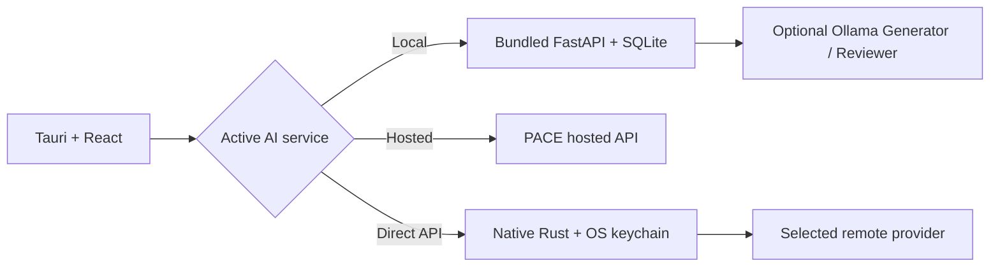

# PACE Desktop 2.0 · Pipelined Actor-Critic Ensemble


[](https://github.com/KiritoTempest175/PACE/actions/workflows/desktop-native-ci.yml)

[](LICENSE)

**A local-first workbench for AI models, general conversations, PDFs and programming.** This existing desktop branch is separate from the production web branch.

[**Install from the web dashboard**](https://pace.huzaifazaman.com/) · [**Setup**](desktop/README_LOCAL.md) · [**2.0.0 notes**](desktop/RELEASE_NOTES_v2.0.0.md) · [**Web branch**](https://github.com/KiritoTempest175/PACE/tree/main) · [**Issues**](https://github.com/KiritoTempest175/PACE/issues)

## Features

| Workspace or capability | What it does |
| --- | --- |
| **Coding** | Code generation, explanation, file extraction and a browser-based Python WebAssembly worker |
| **Literacy** | Conversational chat; add a PDF for document-grounded questions |
| **Local** | Bundled FastAPI + SQLite, optional Ollama models; separate Generator and Reviewer selections |
| **Hosted** | PACE hosted API, chosen from the top bar |
| **External API** | Native requests to configured OpenAI-compatible, OpenRouter, Anthropic, Google or custom models |
| **Fast / Pro** | Single generation vs optional second model review; review is not a correctness guarantee |

## Choose where your prompt goes

**Active AI service** is shown at the top of the desktop interface. Select **Local**, **Hosted** or any saved **API** provider in one action, without visiting Preferences. The label shows the current provider; switching clears conversation and PDF context to avoid accidental cross-provider sharing.



Using a remote API transmits your prompt off-device and may cost money. The direct-provider pathway does not automatically attach local PDF context.

## Installers and backup

The [PACE web dashboard](https://pace.huzaifazaman.com/) will show direct links to a verified public 2.0.0 release when available: Windows x64 EXE, macOS Apple Silicon DMG, Linux x64 DEB and optional AppImage. All are unsigned. Verify checksums before opening.

The 2.0.0 GitHub release attaches **complete editable source archives for web and desktop**, in addition to installers, checksums and the full installation guide. The desktop branch can also be downloaded from GitHub's Code → Download ZIP menu.

## Run from source

Requirements: Python 3.11, Node.js 22, stable Rust, native toolchains and the dependencies listed in [desktop setup](desktop/README_LOCAL.md).

```bash
git clone --branch feature/tauri-desktop https://github.com/KiritoTempest175/PACE.git
cd PACE
python -m venv .venv
# activate the virtual environment
python -m pip install -r desktop/requirements-local.txt
python -m pip install -r requirements-dev.txt
python -m pytest -q tests
cd frontend
npm ci
npm run lint
npm test
```

A complete native installer additionally requires freezing the Python backend as `pace-api`, embedding the correct target-triple binary under `frontend/src-tauri/binaries/`, generating Tauri icons, and building branded installer art. Use the [native CI workflow](.github/workflows/desktop-native-ci.yml) as the reference for all three operating systems.

## Security, privacy and known limitations

- The local backend uses loopback with an ephemeral caller secret.
- External API keys are stored in OS keychain service `app.pace.workspaces.byok`, not plaintext client configuration.
- PDFs are validated, extracted to text, and associated with the selected backend's session storage; original upload binaries are removed.
- Model weights and Ollama are not bundled. A discovered GGUF/safetensors file might not be runnable.
- Python execution in a WebAssembly worker is not a hardened sandbox; never execute untrusted generated code.
- Native installers are unsigned and unnotarized; build CI does not replace clean-machine installation tests.

**Maintainer:** [Muhammad Huzaifa Zaman](https://huzaifazaman.com) · [GitHub](https://github.com/KiritoTempest175) · [Contact](mailto:huzaifazaman38@gmail.com). MIT [license](LICENSE).
