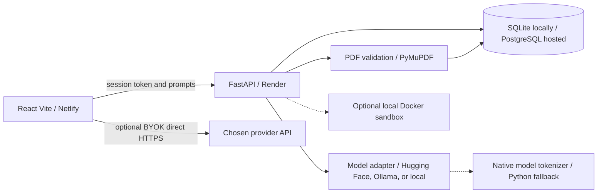
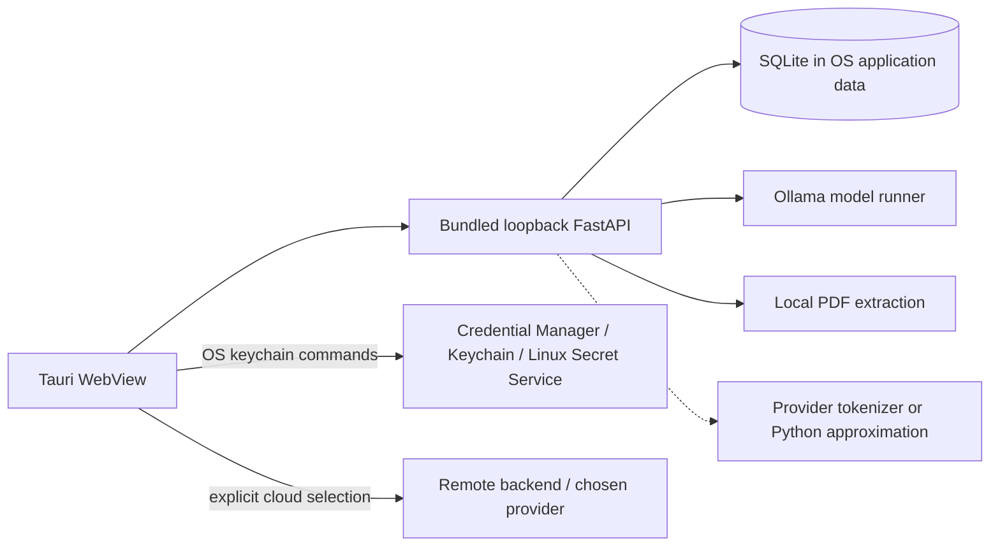

# PACE release architecture, operations and privacy

**Status:** developer release candidate. Do not describe unverified functionality as production-certified.

## Product scope

Coding and Literacy are the only two new-session workspaces. The browser Python runner uses Pyodide in a local worker and is **not** a hardened sandbox. The older project includes experimental Python actor/critic training code retained for compatibility; Research is not an available API mode.

### Fast vs Pro contract

- **Fast:** one actor generation, subject to the configured provider's own output and context limits.
- **Pro:** actor produces a draft, then a critic or second pass reviews and returns the final response. The same model may be used twice, especially with hosted services. Separate weights are not guaranteed. Do not label the output independently validated unless independent models actually executed.
- **Provider-specific note:** Browser direct OpenAI-compatible/Anthropic/Google/OpenRouter calls make one (Fast) or two (Pro) provider requests. These are potentially billable. Ollama generates local drafts and bounded continuations; Pro uses selected desktop actor/critic models when configured. Hosted HF may use a single model for both stages.
- **Stages:** UI starts with Actor drafting; for backend Pro, Critic indicators are best-effort because provider APIs do not always expose an explicit stage. This is not instrumentation proof.

## Web architecture



The current repository does not prove an operational Rust PyO3 tokenizer. The Python/actual model tokenizer path remains the reliable path. Hosted code execution uses browser Pyodide, not the Render backend sandbox.

## Desktop architecture



Model scan looks in common GGUF/safetensors/LM Studio/Hugging Face folders without uploading files; discovery **does not mean loading works**. Direct GGUF/safetensors is currently marked unsupported. Ollama is the supported local runner. CPU-only execution may work with compatible model sizes, with slower output. VRAM fit is unknown unless measured locally against the selected model.

## Privacy and retention

### Web app

The web UI sends prompts, session-token headers and uploaded PDFs to the configured API. Uploaded PDF binary files are deleted after parsing, but extracted PDF text is saved as a document in the backend database. Per-session records include conversation ID/title/workspace/timestamps, message role/text/source/status/timestamps, extracted PDF content, document attachment links, and a SHA-256-derived session owner. Database location is controlled by `DATABASE_URL`: SQLite in local development, PostgreSQL when configured by hosting. The provider receives the prompt and relevant document excerpts to generate responses. Provider retention and backups are independent of PACE.

`DATA_RETENTION_DAYS=30` is the default. The API purges expired conversations and documents **on startup only**, so the real elapsed storage duration can exceed 30 days while the process remains up. A scheduled cleanup service or job is needed for an exact retention SLA. `DELETE /my-data` deletes the current session's records immediately from the configured live database, not backups, logs, third-party provider copies, or records associated with a lost session token. A client-side Delete my data control calls this endpoint.

Browser BYOK credentials are held **in memory**, not localStorage; they disappear on refresh and are included only in direct HTTPS requests to the selected API provider. They never travel through the PACE FastAPI server in the direct-provider code path. Provider CORS restrictions may block browser requests. Use desktop with a supported credential store instead.

### Desktop with bundled backend

When configured for the bundled loopback API plus Ollama/local inference, AI prompts, extracted PDFs, and conversations stay within the user's machine. Model downloads, updates and unrelated system traffic can still use the network. Choosing the hosted backend or a remote provider sends prompt data outside the device, so the interface shows Local vs Cloud. Desktop BYOK keys are designed to be stored in OS credential services and read into process memory only when required. Cross-OS availability and threat-model validation require native build/runtime tests; no security claims about unverified platforms.

## Never silently truncated

The API uses an explicit input token estimate, currently `(len(text)+2)//3`, conservative but **not provider tokenization**. Above `MAX_PROMPT_TOKENS_ESTIMATE`, requests fail with HTTP 413; inputs are never silently sliced. Maximum Pydantic input length is 250,000 characters, a resource safety ceiling. A total output-character guard (`MAX_STREAM_OUTPUT_CHARS`, default 1,000,000) and timeout remain. Streaming emits SSE keep-alives (comments), a final done event, or explicit error. On failure the UI preserves partial visible output and offers Continue; it does not currently support idempotent SSE reconnection with replay offsets.

For Ollama, `done_reason=length` or an unfinished Markdown code fence triggers bounded auto-continuation up to `MAX_CONTINUATION_ROUNDS=3`, with suffix overlap deduplication. This is not guaranteed for HF or other provider adapters because their completion metadata and proxy time limits differ. Netlify proxy rewrites can time out; currently the frontend calls the configured API URL directly. Render Free and HF ZeroGPU impose separate time and quota constraints.

## Setup

```bash
cp .env.example .env
python -m venv .venv
pip install -r backend/requirements.txt
uvicorn backend.main:app --port 8000
cd frontend
npm ci
npm run dev
```

Set `AI_PROVIDER=ollama` and `OLLAMA_MODEL` for an available local model, `AI_PROVIDER=huggingface` plus the correct `HF_SPACE_ID` for hosted inference, or `AI_PROVIDER=disabled` for CRUD-only mode. Never check in provider tokens or credentials.

For production builds:

```bash
cd frontend
npm ci
npm run lint
npm test
npm run build
cd ..
pytest -q tests
```

Netlify serves `frontend/dist`; SPA fallback `/* /index.html 200` already exists in `netlify.toml` and `frontend/public/_redirects`. `netlify.toml` currently **defines VITE_API_BASE_URL explicitly**, so an environment variable set in the Netlify dashboard may not override it; check the committed value before building. Keep Render CORS restricted to actual frontend origins. Do not configure HF credentials in frontend Vite variables.

### Hosting handoff (do not change automatically)

1. In Render, open service `pace-phase2-api` (not the older `pace-backend` from a different repo). Under Settings → Build & Deploy, set the Git branch to `main` for `KiritoTempest175/PACE`. Keep auto deploy off if manual publication is required.
2. Check Docker/build command, env vars (`DATABASE_URL`, `AI_PROVIDER`, `HF_SPACE_ID`, `CORS_ORIGINS`) and health path; then deploy and observe a fresh `/health` result and smoke inference **manually**.
3. In Netlify, verify the project's production branch is `main`, base `frontend`, build `npm ci --no-audit --no-fund && npm run build`, publish `frontend/dist` under the base rules, and `VITE_API_BASE_URL` points to the intended Render URL. `netlify.toml` takes precedence over the UI for this variable.
4. Confirm Hugging Face via the actual `HF_SPACE_ID` in Render (do not assume the account's username reveals it), check authenticated access/quota and compare a real provider response to the UI.
5. Re-run signed/unsigned installers and CPU/GPU execution on physical hardware before claiming Windows/macOS/Linux compatibility.

## Troubleshooting

- API unavailable: check `/health`, provider configuration, Render cold start, CORS and browser network tab.
- Browser BYOK test fails: provider may block CORS or require billing, even if key is correct. PACE never proxies keys.
- Pro fails on long input: two-pass review includes draft and prompt and may exceed context. Split the request.
- PDF isn't found: documents belong to an anonymous session token; losing the token loses access. Verify extraction size/page limits.
- Model scanned but won't load: direct GGUF/safetensors loading is not part of the verified runtime.
- Linux keychain unavailable: verify an unlocked Secret Service implementation is present; refuse to fall back to plaintext key storage.
- Runner fails: Pyodide worker is separate from the server sandbox, with limits and unsupported native packages.
